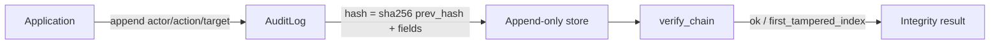

<p align="center">
  
</p>

<h1 align="center">Audit Log</h1>

<p align="center">
  <strong>Tamper-evident, append-only audit log with SHA-256 hash chaining — in Python.</strong><br>
  Append events, get a cryptographic chain, and prove integrity (or pinpoint tampering) offline.
</p>

<p align="center">
  <em>Built and maintained by <a href="https://viprasol.com">Viprasol Tech</a> — Fintech Experts. Full-Stack Builders.</em>
</p>

<p align="center">
  <a href="https://github.com/Viprasol-Tech/audit-log/actions/workflows/ci.yml"></a>
  <a href="LICENSE"></a>
  
  <a href="https://t.me/viprasol_help"></a>
  <a href="https://github.com/Viprasol-Tech/audit-log/stargazers"></a>
</p>

---

## Features

- **Hash-chained entries** — every entry's SHA-256 digest covers its own fields plus the previous entry's hash, so the whole history is bound together.
- **Tamper detection** — `verify_chain` confirms integrity and reports the exact index where tampering first occurred.
- **Append-only store** — an in-memory store that raises `AppendOnlyError` on any attempt to mutate or delete a record.
- **Deterministic hashing** — canonical JSON encoding means the same events always produce byte-identical hashes across processes and platforms.
- **Zero external services** — pure stdlib `hashlib` for crypto; runs fully offline.
- **CLI** — `audit-log demo` builds a chain, prints it, tampers with it, and catches the tampering.
- **Modern tooling** — ruff, mypy (strict), pytest, GitHub Actions CI.

## Quickstart

```bash
git clone https://github.com/Viprasol-Tech/audit-log.git
cd audit-log
python -m pip install -e ".[dev]"

# Append a chain, then tamper with it and detect the change:
audit-log demo
```

## Usage

```python
from audit_log import AuditLog, verify_chain

log = AuditLog()
log.append("alice", "login", "console", {"ip": "10.0.0.1"})
log.append("bob", "delete", "record:42", {"reason": "cleanup"})

result = verify_chain(log.entries)
assert result.ok  # True — the chain is intact

# Tamper with a persisted entry and the chain breaks at that index:
entries = log.entries
forged = entries[0].model_copy(update={"actor": "mallory"})
broken = verify_chain((forged, *entries[1:]))
assert not broken.ok
assert broken.first_tampered_index == 0
```

## Architecture



## Roadmap

- [x] Hash-chained entries with genesis prev_hash
- [x] `verify_chain` with first-tamper index reporting
- [x] Append-only in-memory store
- [ ] Pluggable durable backends (SQLite, file-per-day)
- [ ] Merkle anchoring and external timestamp proofs
- [ ] Signed checkpoints for multi-writer logs

## Contributing

PRs welcome — see [CONTRIBUTING.md](CONTRIBUTING.md) and our [Code of Conduct](CODE_OF_CONDUCT.md).

## Contact — Viprasol Tech Private Limited

- Website: [viprasol.com](https://viprasol.com)
- Email: [support@viprasol.com](mailto:support@viprasol.com)
- Telegram: [t.me/viprasol_help](https://t.me/viprasol_help) | WhatsApp: +91 96336 52112
- GitHub: [@Viprasol-Tech](https://github.com/Viprasol-Tech) | [LinkedIn](https://www.linkedin.com/in/viprasol/) | X [@viprasol](https://twitter.com/viprasol)

## License

[MIT](LICENSE) (c) 2025 Viprasol Tech Private Limited
